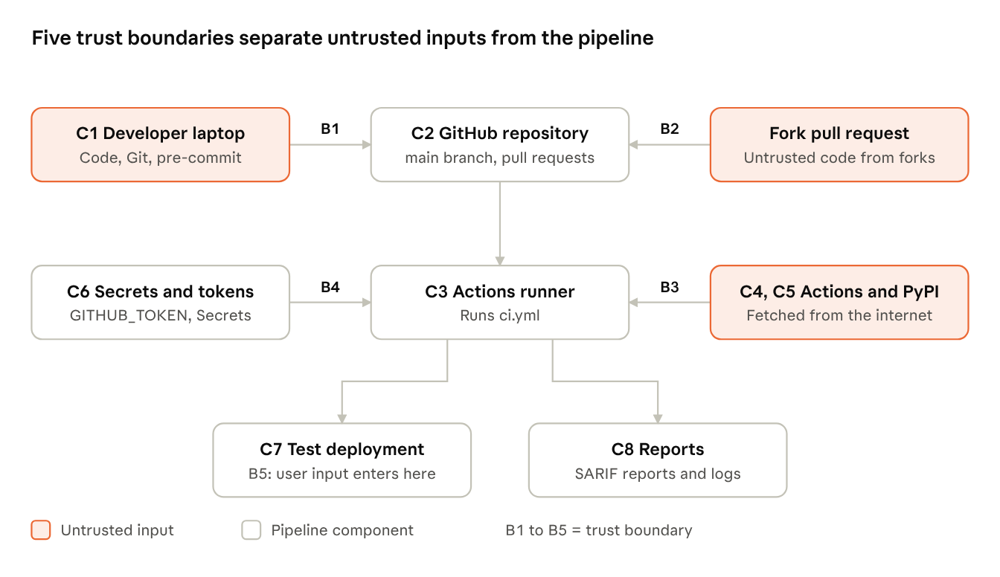

# T3 Threat Model: Secure Software Development Pipeline

Nov 3, 2026 · @Yahya Kamel

## 1 Introduction

This threat model identifies 19 threats to the sample Flask application and its GitHub Actions pipeline, and maps every threat to a pipeline control and a project task. It delivers task T3 and the threat model part of objective O2.

The STRIDE method was used. STRIDE groups threats into six types: Spoofing, Tampering, Repudiation, Information disclosure, Denial of service and Elevation of privilege (Shostack, 2014). Each type was checked against every component and every trust boundary in the system.

The pipeline itself is treated as a target, not only the application. The tj-actions/changed-files compromise (CVE-2025-30066) showed that a single third-party action can expose CI/CD secrets in thousands of repositories (NIST, 2025). Supply-chain threats were checked against the OWASP Top 10 CI/CD Security Risks (OWASP Foundation, 2022).

## 2 Scope and system description

The system has eight components. Together they cover the path from a developer's commit to a scanned and tested build.

| ID | Component                  | What it holds or does                                               |
| -- | -------------------------- | ------------------------------------------------------------------- |
| C1 | Developer laptop           | Source code, Git, pre-commit hooks                                  |
| C2 | GitHub repository          | main branch, pull requests, workflow files                          |
| C3 | GitHub Actions runner      | Runs the ci.yml workflow on every push and pull request             |
| C4 | Third-party actions        | For example actions/checkout and actions/setup-python               |
| C5 | Dependencies               | Python packages from PyPI, such as Flask                            |
| C6 | Secrets and tokens         | GITHUB\_TOKEN and values stored in GitHub Secrets                   |
| C7 | Test deployment            | The Flask application running in the pipeline for the ZAP scan (T9) |
| C8 | Scan reports and artefacts | SARIF reports and pipeline logs                                     |

The sample application is a small Python Flask application with the routes /, /health and /about. Seeded vulnerable fixtures will be added in T6.

## 3 Data flow and trust boundaries

Code and data cross five trust boundaries on their way through the pipeline. Every boundary is a point where an attacker could enter, so each one has at least one threat and one control in sections 4 and 5.

Data flow diagram · 8 components, 5 trust boundaries

| ID | Trust boundary                      | Why it matters                                         |
| -- | ----------------------------------- | ------------------------------------------------------ |
| B1 | Developer laptop to GitHub          | A push may carry secrets or come from a stolen login   |
| B2 | Fork pull request to repository     | Code from outside contributors cannot be trusted       |
| B3 | Runner to the internet              | Actions and packages are downloaded from third parties |
| B4 | Runner to secrets                   | Secrets are exposed to whatever code runs in the job   |
| B5 | User input to the Flask application | Input may carry injection or traversal attacks         |

## 4 Pipeline threats

Thirteen threats target the pipeline. Five of them are already controlled (marked Done): four in the current ci.yml and one through branch protection on main.

| ID    | STRIDE type            | Threat                                                                              | Where | Control                                                                          | Task     | Status  |
| ----- | ---------------------- | ----------------------------------------------------------------------------------- | ----- | -------------------------------------------------------------------------------- | -------- | ------- |
| S1 | Spoofing               | An attacker pushes code using a stolen GitHub login                                 | B1    | Two-factor authentication; branch protection with pull requests required         | T5       | Done |
| S2 | Spoofing               | A fork pull request runs as if trusted and gains access to secrets                  | B2    | Use the pull\_request trigger, never pull\_request\_target; no secrets for forks | T12      | Planned |
| T1 | Tampering              | A third-party action is replaced with malicious code, as in the tj-actions incident | B3    | Pin every action to a full commit SHA                                            | T5       | Done    |
| T2 | Tampering              | A malicious or vulnerable PyPI package is installed                                 | B3    | Pinned dependency versions; Trivy SCA                                            | T8       | Planned |
| T3 | Tampering              | A pull request edits ci.yml to skip the scanners                                    | B2    | Required status checks; gate fails if any scanner is skipped                     | T11, T12 | Planned |
| R1 | Repudiation            | A security exception is added with no record of who approved it                     | C2    | Exception file with reason, approver and expiry date; Git history as audit log   | T11      | Planned |
| I1 | Information disclosure | A secret is committed to the repository                                             | B1    | Gitleaks in pre-commit and in CI                                                 | T7       | Planned |
| I2 | Information disclosure | The Git credential is left on the runner after checkout                             | C3    | persist-credentials: false                                                       | T5       | Done    |
| I3 | Information disclosure | A secret is printed in the build logs                                               | B4    | Minimal secrets; GitHub log masking; SHA pinning                                 | T12      | Planned |
| D1 | Denial of service      | A stuck run blocks the pipeline                                                     | C3    | 10 minute job timeout                                                            | T5       | Done    |
| D2 | Denial of service      | The DAST scan hangs or runs too long                                                | C7    | Time-limited ZAP baseline scan                                                   | T9       | Planned |
| E1 | Elevation of privilege | The workflow token has write permissions it does not need                           | C3    | permissions: contents: read                                                      | T5       | Done    |
| E2 | Elevation of privilege | A pull request title is injected into a run command                                 | B2    | actionlint and zizmor workflow scanning                                          | T8       | Planned |

## 5 Application threats

Six threats target the Flask application. Together they cover all eight CWE types in the labelled fixture set (T6), so every fixture traces back to a threat (MITRE, 2026).

| ID    | STRIDE type            | Threat                                                              | CWE                    | Where  | Control                    | Task   |
| ----- | ---------------------- | ------------------------------------------------------------------- | ---------------------- | ------ | -------------------------- | ------ |
| T4 | Tampering              | Injection through user input into SQL, shell commands or HTML pages | CWE-89, CWE-78, CWE-79 | B5     | Semgrep; ZAP baseline scan | T7, T9 |
| T5 | Tampering              | An outdated library with a known vulnerability is used              | CWE-1104               | C5     | Trivy SCA                  | T8     |
| I4 | Information disclosure | Path traversal lets a user read files outside the intended folder   | CWE-22                 | B5     | Semgrep                    | T7     |
| I5 | Information disclosure | An API key is written in the source code                            | CWE-798                | C1, C2 | Gitleaks; Semgrep          | T7     |
| I6 | Information disclosure | Passwords are hashed with MD5 and are easy to crack                 | CWE-327                | C7     | Semgrep                    | T7     |
| E3 | Elevation of privilege | Untrusted data loaded with pickle runs attacker code                | CWE-502                | B5     | Semgrep                    | T7     |

## 6 Controls already implemented

Four controls are already in .github/workflows/ci.yml, ahead of the plan. Each follows the GitHub guidance on hardening Actions workflows (GitHub, 2026).

| Control in ci.yml                   | Threat | Why it works                                                          |
| ----------------------------------- | ------ | --------------------------------------------------------------------- |
| Actions pinned to a full commit SHA | T1  | A SHA cannot be moved to new code, unlike a tag such as v4            |
| permissions: contents: read         | E1  | The token can read the code but cannot change the repository          |
| persist-credentials: false          | I2  | The Git credential is not left on the runner for later steps to steal |
| timeout-minutes: 10                 | D1  | A stuck job is stopped instead of blocking the pipeline               |

Branch protection on main was added on 18 November 2026 (task T5). It requires a pull request and a passing build-and-test check before any change reaches main, which controls S1. Two-factor authentication on the maintainer account completes this control.

The remaining 14 threats will be controlled in tasks T5 to T12, as shown in sections 4 and 5.

## 7 Assumptions and out of scope

**Assumptions**

  - GitHub and its hosted runners are trusted to work as documented.

  - The repository is public and has one maintainer, who approves all merges.

  - All seeded secrets and credentials are fake.

**Out of scope**

  - Attacks on GitHub's own infrastructure.

  - Production deployment and hosting; only an isolated test deployment is used.

  - Physical theft of the developer laptop.

  - Social engineering of the maintainer.

## References

GitHub (2026) *Security hardening for GitHub Actions*. Available at: https://docs.github.com/en/enterprise-server@3.13/actions/how-tos/security-for-github-actions/security-guides/security-hardening-for-github-actions (Accessed: 27 October 2026).

MITRE (2026) *Common Weakness Enumeration (CWE)*. Available at: https://cwe.mitre.org/ (Accessed: 27 October 2026).

NIST (2025) *CVE-2025-30066 detail*. National Vulnerability Database. Available at: https://nvd.nist.gov/vuln/detail/CVE-2025-30066 (Accessed: 27 October 2026).

OWASP Foundation (2022) *OWASP Top 10 CI/CD Security Risks*. Available at: https://owasp.org/www-project-top-10-ci-cd-security-risks/ (Accessed: 27 October 2026).

Shostack, A. (2014) *Threat modeling: designing for security*. Indianapolis, IN: Wiley.
